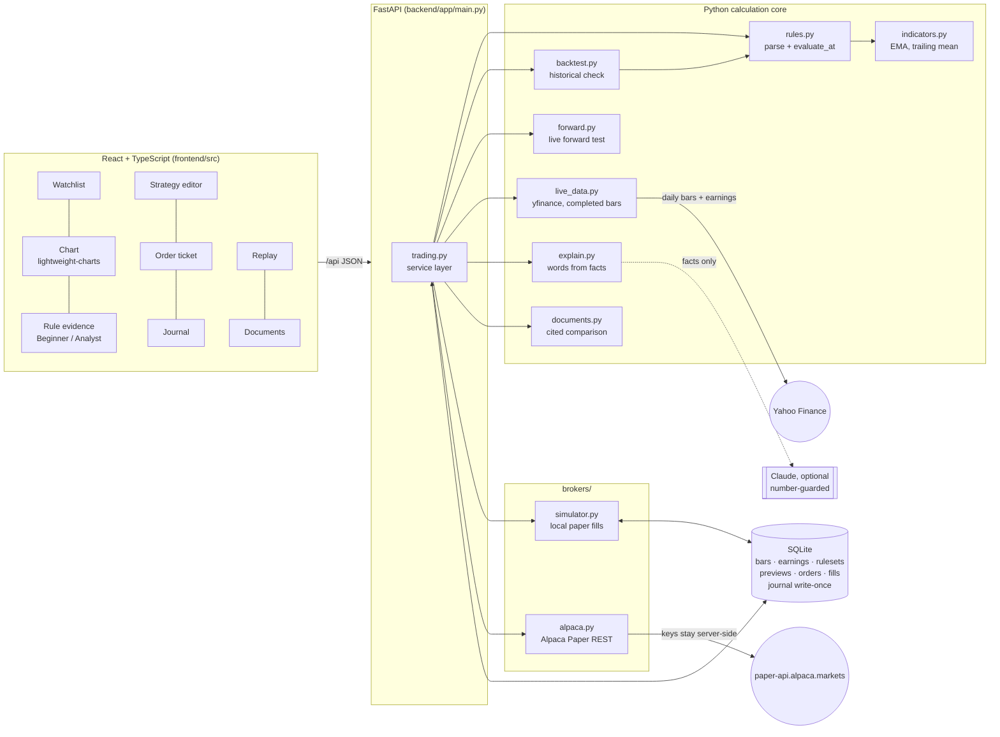

# Architecture

## One evaluator, many consumers

`rules.evaluate_at(series, i, params, ...)` is the only place a pass, fail or unknown result is decided. It reads bars `0..i` and nothing after. Everything else consumes its output:

| Consumer | Uses |
|---|---|
| Watchlist screen | Status per ticker, rule dots, near-miss reason |
| Evidence panel | Rules table, facts with `inputs` for click-through |
| Explanations | The same evaluation dict, rendered as Beginner or Analyst text. The numbers aren't recomputed. |
| Order preview | `suggested_stop`, `entry_assumption`, `plan`. A preview can only be created when the status qualifies. |
| Journal | A frozen copy of the evaluation, the rule set JSON and the data timestamp, stored write-once (an SQLite trigger blocks UPDATE) |
| Replay | `signal_flags()` uses identical core logic. A test asserts it matches `evaluate_at` bar for bar. |

## Real-time updates

`app/streaming.py` runs a background thread while a broker is active in Live data mode. For Alpaca it holds the `trade_updates` websocket and applies each event via `broker_sync.apply_event` (the same code path the REST sync uses, so pushed and polled updates can't disagree). For IBKR it polls. Each change bumps a counter in `app/events.py`, and `/api/stream` (Server-Sent Events) tells open browsers to refresh. Mutating API calls and scheduler jobs bump it as well.

`app/day_monitor.py` is a third background thread, active on trading days from 09:30 to 16:05 ET. Every 30 s it advances the live intraday simulator session, syncs broker day trades, and from the flat-by time (15:55) cancels unfilled broker day-trade entries and sells open ones at market (`broker_sync.flatten_day_trade`). Day trades reach Alpaca as bracket orders (`AlpacaPaperBroker.submit_bracket`: DAY time in force, take-profit limit plus stop). `broker_sync.apply_result` maps the bracket legs to local `stop` and `target` rows. `day.route()` is the single place that decides between the simulator and the broker.

## Data modes

`db.data_mode()` (stored in `backend/data/settings.json`) selects `swingdesk-demo.db` or `swingdesk-live.db`. Both run the same code path. The only differences are where new sessions come from (`POST /api/sim/advance` reveals the next seeded bar, `POST /api/live/refresh` fetches real completed bars) and that the live watchlist can be edited. In both, each new session is passed to `simulator.process_session` in date order, so paper orders behave identically.

`forward.record()` runs after every screen. It inserts each qualifying setup once per (symbol, signal date, rule version), and `forward.update()` follows it on later bars. Because recording happens only on the latest completed bar, the forward test can't use hindsight.

## Request flow for the core workflow

1. `POST /api/strategy/parse` turns plain English into a draft (params plus a definition for every vague phrase).
2. `POST /api/rulesets` saves it as a confirmed version (`version` is UNIQUE and increments).
3. `GET /api/watchlist/screen` runs `evaluate_at` on the last completed bar for each ticker.
4. `POST /api/previews` sizes the trade, estimates the loss and stores the preview with a server-generated id.
5. `POST /api/orders {preview_id, confirm:true}` → `client_order_id = preview_id`, which is UNIQUE in SQLite and is also sent to Alpaca as its `client_order_id`. A second submit returns 409 with the original order. The journal row is written in the same transaction.
6. `POST /api/sim/advance` processes one hidden session: open fills, then intraday stops, then the planned exit at the close. Then `refresh_outcomes` computes realized P&L and plan adherence.

## Guardrails

- **Paper only.** The simulator is the default. The Alpaca adapter hard-fails on any base URL without `paper` in it. The mode is shown in the top bar and on the order ticket.
- **Stale data.** Submitting a preview after the simulator clock has moved is rejected, so you can't trade on evidence that has since changed.
- **Earnings acknowledgement.** A warn-mode earnings flag needs an explicit checkbox, which is recorded in the plan and checked in the adherence review.
- **LLM containment.** The model sees computed facts only. A reply that introduces a number not in those facts is discarded.

## Copilot

`app/copilot.py` holds the system prompt, the tool definitions, the tool loop and proposals.
- **Read tools** call the same service functions as the API: `trading.evaluate_symbol`, `trading.load_series` plus the `indicators` functions, `risk.limits`, `forward.summary`, `day.state` and `day.screen`.
- **Propose tools** only insert a row into `copilot_proposals`. Swing and day-trade proposals run `trading.make_preview` / `day.preview`, so the model sees the real sizing and risk results.
- `copilot.apply()` is the user's click. It reuses `confirm_ruleset`, `risk.save_limits`, `cancel_order`, `broker_sync.manual_close` and `day.flatten`. For orders it only tells the client to open the ticket.
- Each turn appends the assistant's full content (thinking blocks included) and returns every tool result in one user message.
- Conversations are JSON in `copilot_threads`. `CLIENT_FACTORY` lets the tests supply a scripted client.

## Linked accounts and crypto orders

- `app/linked.py` reads balances from other accounts: ccxt exchanges, Robinhood Crypto, moomoo/Futu OpenD and a Solana wallet address. `linked.exchange(acc)` builds the ccxt client, with sandbox mode when the account was linked as a test account.
- `app/crypto_trading.py` routes spot orders through ccxt, to sandbox accounts only. It writes its own `crypto_orders` table (entry, stop and exit rows linked by `parent_id`) and never touches the stock `orders` and `journal` tables, so stock-specific code (planned exits, the simulator, PDT) can't misread crypto rows.
- `DayMonitor._crypto()` syncs crypto orders every 30 s around the clock.

## Portal, live switches and MCP

- **Per-user data:** `db.TENANT` (a context variable) points `db.data_dir()` at the signed-in user's folder. The `portal_auth` middleware sets it per request, `portal.as_user()` sets it for MCP calls, and `portal.for_each_tenant()` runs background jobs once per user.
- **Secrets:** in a user's context, `credentials.backend()` returns that user's `EncryptedStore`.
- **Live switches:** `live_gate.py` is the per-account switch for stocks (Alpaca or IBKR). `linked.set_live()` is the switch for each crypto account. `crypto_trading._account()` accepts testnet accounts, or real accounts whose switch is on.
- **MCP:** `mcp_server.py` serves the copilot's tool list over JSON-RPC and runs `copilot.run_tool`, so the same guardrails apply as in the app.

